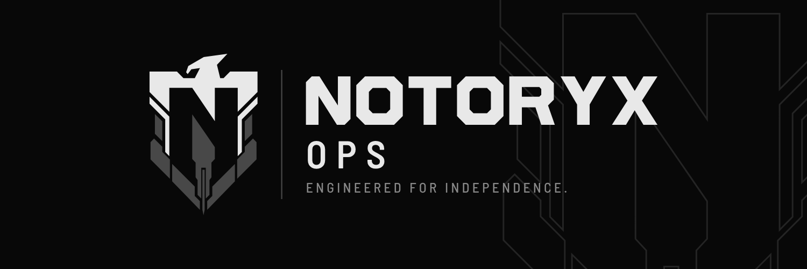
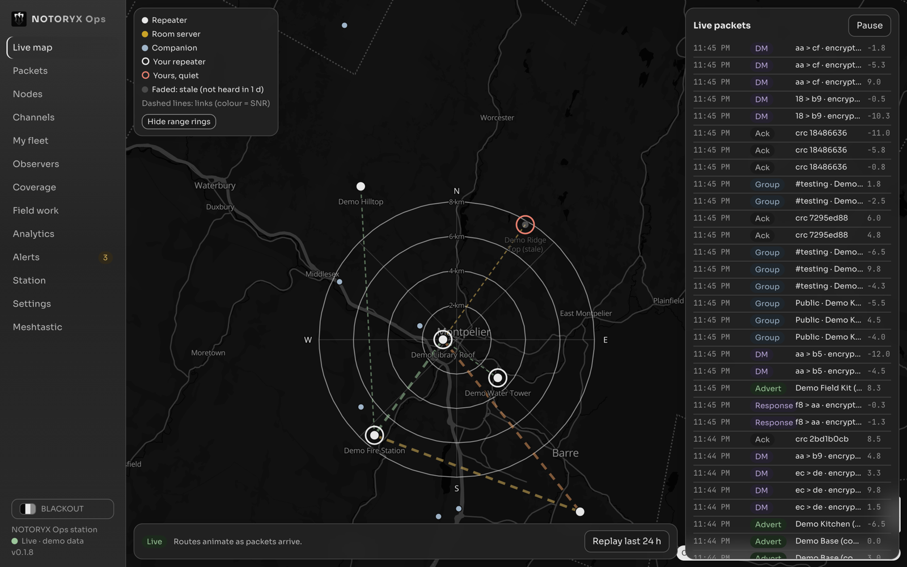
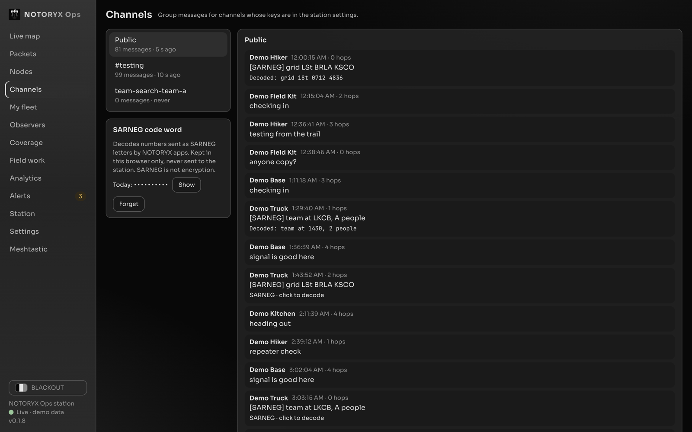
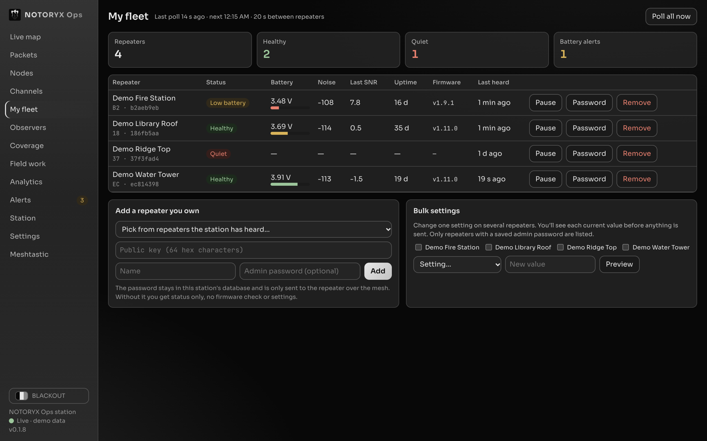
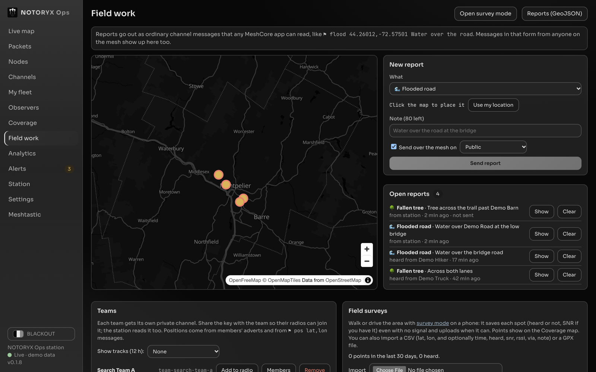
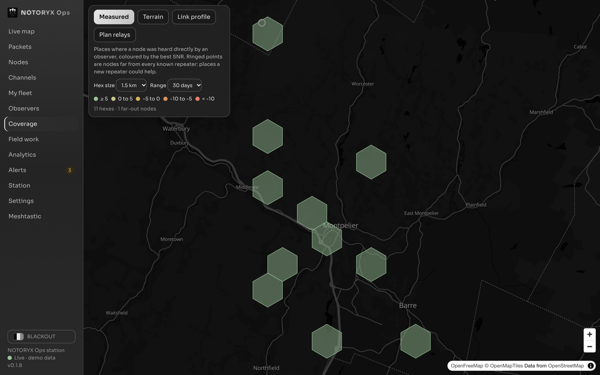

<p align="center"></p>

# NOTORYX Ops releases

Downloads for NOTORYX Ops, a MeshCore network dashboard and infrastructure station for a Raspberry Pi, a Mac (as its own app window) or Docker.



- **Live map:** packets from the station radio and MQTT observers drawn as routes as they arrive, a 24-hour replay, range rings, faded stale nodes and an ignore list. Plus a packet feed with a decoder, a node list, observer health and analytics with a prefix clash check.
- **Channels and SARNEG:** channel messages, with click-to-decode for SARNEG messages from the NOTORYX phone apps. The code word stays in your browser. Decoding only; SARNEG is not encryption. [What SARNEG is](https://meshmayhem.org/notoryx/#sarneg).
- **Fleet:** health, history and alerts (Discord or webhook) for the repeaters you own, plus bulk settings that show current values before anything is sent.
- **Coverage and planning:** measured coverage, terrain coverage around any spot, a link profile with line of sight and a signal budget, relay suggestions on high ground, and predictions tuned against links the station has actually heard. Elevation comes from free Copernicus data, downloaded once per area.
- **Field work:** hazard reports (flooded road, fallen tree, power line down and more) sent and received as plain channel messages any MeshCore app can read, teams on their own private channels with position tracks, and a phone survey mode that keeps working with no signal.
- **Integrations:** optional accounts with viewer, operator and admin roles, GeoJSON and GPX exports, Prometheus metrics, a read-only public map (off by default), Home Assistant sensors over MQTT and a PostgreSQL archive.
- **Reach:** test the mesh from the station radio: who can hear me, trace route through repeaters you pick, and find a route to any node, drawn on a map.
- **Offline maps and kiosk:** the station keeps the map tiles it shows and downloads whole areas ahead of time (MBTiles export and import), and `/kiosk` turns a Pi with a touchscreen into a desk or wall screen.
- **Privacy:** the Station page lists everything that can leave the station and whether it's on. Every build fails if code can reach the network without being on that list, or if anything that sends radio data is on by default.
- **Looks:** BLACKOUT, Aurora, Ember, Nebula, Graphite and Sandstone.

| | |
|---|---|
|  **Channels** with SARNEG decoded |  **My fleet** |
|  **Field work** |  **Coverage** |

Screenshots are from demo mode with made-up nodes, in the BLACKOUT look.

## Latest

- **[NOTORYX Ops 0.1.22 test 23](../../releases/tag/v0.1.22-test.23)** (26 November 2026): Reach page, offline maps, what leaves this station, kiosk screen
- **[NOTORYX Ops 0.1.21 test 22](../../releases/tag/v0.1.21-test.22)** (26 November 2026): templates explained on the Meshtastic page
- **Meshtastic add-on 0.1.6**, included with both

## Which file

| File | For |
|---|---|
| `notoryx-ops-<version>-pi.tar.gz` | Raspberry Pi or other Debian-based Linux. Unpack, then `sudo ./install.sh` (and `./kiosk.sh` for a touchscreen) |
| `notoryx-ops-<version>-mac.zip` | Mac. Needs Python 3.10+ from python.org. Unsigned: right-click the app and choose Open the first time |
| `notoryx-ops-<version>-docker.zip` | Docker. Unzip, then `docker compose up -d` |
| `notoryx_ops-<version>-py3-none-any.whl` | Any computer with Python 3.10+: `pip install` it, then `notoryx-ops run --open` |
| `notoryx-ops-<version>-source.tar.gz` | Source code (MIT, except the Meshtastic add-on, which is GPL-3.0) |
| `SHA256SUMS` | Checksums for every file |

To try it without a radio: `notoryx-ops run --demo --open` fills the dashboard with made-up traffic.

The dashboard opens at `http://127.0.0.1:8484`. Settings live in a `config.toml` that's created with comments on first start.

## Meshtastic add-on (optional)

`notoryx_ops_meshtastic-<version>-py3-none-any.whl` is a separate download. It gives the station its own Meshtastic radio, remote admin of other Meshtastic nodes over the air (firmware 2.5+), settings templates with compliance checks, and an optional Meshtastic⇄MeshCore channel bridge. Install it into the station's Python environment, then restart the station:

```
pip install notoryx_ops_meshtastic-<version>-py3-none-any.whl
```

On the Mac app that environment is `~/Library/Application Support/NOTORYX Ops/venv`. The add-on is GPL-3.0 because it uses the Meshtastic Python library; NOTORYX Ops itself is MIT and works without it. Meshtastic® is a registered trademark of Meshtastic LLC; this add-on is not affiliated with Meshtastic LLC.

## Status

Test builds. What has been checked on real hardware:

- **Station:** a Mac station with a MeshCore companion radio over Bluetooth: live packets, the map, stale nodes, the ignore list and range rings.
- **Hazard reports:** a report and its all-clear sent on a test channel, the repeater echo heard once and not duplicated.
- **Meshtastic add-on:** connecting to the station's own Meshtastic radio, reading and changing settings on a second node over the air, renaming it, setting a favourite, rebooting it, and the channel bridge in both directions without echo loops.

- **SARNEG decoding:** checked on the installed 0.1.8 Mac build with demo messages (not yet with messages heard over the air).

Not yet checked on hardware: the Reach tools, the kiosk script on a Pi, teams on the radio, applying settings templates through the add-on, and the MeshCore fleet tools on repeaters you own.

## Problems or ideas

Open an issue on this repo.

---
🛠️ AI-assisted: built with Anthropic's Claude, directed and reviewed by [BaconDisk22](https://github.com/BaconDisk22). Checked by automated tests and CI; review before relying on it.
